# Conception logicielle pilotée par l'IA

[English](README.md) · **Français**

Un guide complet pour **concevoir une application de A à Z en dialogue avec une IA (intelligence artificielle)** : du besoin métier jusqu'au premier incrément de code, en passant par les exigences qualité, le domaine, l'interaction avec l'utilisateur, l'architecture, les technologies, les données, la sécurité, l'exploitation et les tests.

Le guide est à la fois :

- une **convention de conception** lisible par un humain : méthode, livrables, listes de contrôle ;
- un **programme de travail pour un agent IA** : un orchestrateur ([`AGENTS.md`](fr/AGENTS.md)), douze prompts de spécialistes ([`prompts/`](fr/prompts/)) et des gabarits de livrables ([`templates/`](fr/templates/)).

L'IA structure, questionne, rédige, vérifie la cohérence et propose. **L'humain — le décideur — connaît le métier, arbitre et valide.**

---

## Le processus

```mermaid
flowchart LR
    subgraph P["Problème"]
        P1["1 · Cadrage"] --> P2["2 · Analyse<br/>fonctionnelle"] --> P3["3 · Exigences<br/>qualité"]
    end
    subgraph D["Pont"]
        P4["4 · Modélisation<br/>du domaine"]
    end
    subgraph S["Solution"]
        P5["5 · Conception<br/>de l'interaction"] --> P6["6 · Architecture"] --> P7["7 · Technologies"] --> P8["8 · Données<br/>et contrats"] --> P9["9 · Sécurité"] --> P10["10 · Exploitation"] --> P11["11 · Tests"] --> P12["12 · Plan et<br/>squelette ambulant"]
    end
    P3 --> P4 --> P5
    P12 --> P13["13 · Évolution<br/>(continue)"]
```



| # | Phase | Question centrale | Méthodes de référence |
|---|---|---|---|
| 1 | [Cadrage](fr/docs/01-scoping.md) | Pourquoi, pour qui, dans quelles limites ? | Vision produit, parties prenantes, objectifs mesurables |
| 2 | [Analyse fonctionnelle](fr/docs/02-functional-analysis.md) | Que doit faire le système ? | Volere, Example Mapping, cas d'utilisation |
| 3 | [Exigences qualité](fr/docs/03-quality-requirements.md) | Avec quel niveau de qualité ? | Scénarios qualité, ISO (International Organization for Standardization) 25010 |
| 4 | [Modélisation du domaine](fr/docs/04-domain-modeling.md) | Comment le métier est-il structuré ? | DDD (Domain-Driven Design) stratégique, Event Storming |
| 5 | [Conception de l'interaction](fr/docs/05-interaction-design.md) | Comment l'utilisateur accomplit-il ses tâches ? | Conception centrée sur l'humain (ISO 9241-210), scénarios d'utilisabilité du SEI (Software Engineering Institute), prototype jetable |
| 6 | [Architecture logicielle](fr/docs/06-software-architecture.md) | Comment organiser le système ? | arc42, C4 (Context, Containers, Components, Code), ADR (Architecture Decision Record) |
| 7 | [Choix technologiques](fr/docs/07-technology-choices.md) | Avec quels outils ? | Grille pondérée, preuves de concept |
| 8 | [Données et contrats](fr/docs/08-data-contracts.md) | Quelles données, quelles interfaces ? | OpenAPI, AsyncAPI, propriété des données |
| 9 | [Sécurité et conformité](fr/docs/09-security-compliance.md) | Contre quoi se protéger ? | STRIDE (Spoofing, Tampering, Repudiation, Information disclosure, Denial of service, Elevation of privilege), ASVS (Application Security Verification Standard), RGPD (Règlement général sur la protection des données) |
| 10 | [Infrastructure et exploitation](fr/docs/10-infrastructure-operations.md) | Où et comment tourne-t-il ? | SLO (Service Level Objective), infrastructure décrite par du code, observabilité |
| 11 | [Stratégie de test](fr/docs/11-test-strategy.md) | Comment prouver la conformité ? | Pyramide des tests, fonctions d'aptitude |
| 12 | [Plan de réalisation](fr/docs/12-delivery-plan.md) | Dans quel ordre construire ? | Squelette ambulant, tranches verticales |
| 13 | [Évolution](fr/docs/13-evolution.md) | Comment la conception reste-t-elle vraie ? | Gestion du changement, garde-fous automatiques |

Chaque phase suit la même boucle — **Charger → Questionner → Proposer → Critiquer → Valider → Consigner → Gate** — et se termine par une **gate** que seul le décideur peut valider.

Ce n'est pas un cycle en cascade : l'ordre dit dans quel sens circule l'information, et les retours en arrière sont prévus et encadrés.

## Principes clés

1. **L'IA n'invente jamais une donnée métier.** Un seuil inconnu est marqué **[seuil à fixer]** et devient une décision ouverte.
2. **Tout est identifié et tracé** : chaque exigence a un identifiant stable (`BR-7`, `QS-3`, `ADR-0004`…), et la chaîne va de l'objectif métier jusqu'au test.
3. **Les exigences qualité pilotent l'architecture**, pas la mode.
4. **Une décision structurante = un ADR**, avec au moins deux options comparées.
5. **L'effort est proportionné** au profil du projet : *Prototype*, *Produit* ou *Critique*.
6. **La conception vit dans des fichiers**, dans le dépôt du projet : un agent peut reprendre le travail sans l'historique de la conversation.

Détails : [`docs/00-principles.md`](fr/docs/00-principles.md).

## Structure du dépôt

```
.
├── AGENTS.md             # Point d'entrée de l'agent : orchestrateur, routage, commandes
├── CLAUDE.md             # Import de AGENTS.md pour Claude Code
├── README.md             # Présentation en anglais (en français : ce fichier, README.fr.md)
├── docs/                 # Le guide, en anglais : la version qui fait foi
│   ├── 00-principles.md  # Normatif : rôles, boucle, règles d'or, identifiants, gates
│   ├── 01 … 13-*.md      # Une fiche de méthode par phase
│   ├── glossary.md       # Acronymes et termes
│   └── bibliography.md   # Ouvrages et références
├── prompts/              # Un prompt par spécialiste + relecteur critique
├── templates/            # Gabarits des livrables écrits dans design/
├── fr/                   # Traduction française pour les lecteurs humains : même structure, mêmes noms de fichiers
└── scripts/
    ├── check_acronyms.py # Vérifie le glossaire et l'expansion des acronymes, dans chaque langue
    ├── check_links.py    # Vérifie les liens, les ancres et les chemins du guide, dans chaque langue
    └── check_translation.py # Vérifie que chaque fichier français suit la version anglaise actuelle
```

Dans le projet conçu, l'agent produit :

```
design/
├── STATE.md  glossary.md  traceability.md
├── 01-scoping.md … 12-delivery-plan.md
├── adr/  contracts/  diagrams/  prototypes/
```

## Démarrage rapide

### 1. Rendre le guide accessible à l'agent

Au choix :

```bash
# a) Cloner le guide à côté de vos projets
git clone https://github.com/ArnaudSene/ai-driven-software-design.git ~/guides/ai-driven-software-design

# b) Ou l'ajouter comme sous-module du projet
git submodule add https://github.com/ArnaudSene/ai-driven-software-design.git .design-guide
```

### 2. Lancer la session de conception

Ouvrez votre agent (Claude Code, ou tout agent capable de lire et d'écrire des fichiers) **à la racine du projet à concevoir**, puis envoyez :

```text
Tu vas conduire la conception de ce projet en suivant le guide situé dans
<chemin-du-guide>. Lis d'abord <chemin-du-guide>/AGENTS.md et applique-le :
tu es l'orchestrateur, je suis le décideur. Les livrables vont dans ./design/,
en français.
Voici mon projet : <description en quelques lignes, et documents disponibles>.
```

Si vous avez déjà des documents (analyse fonctionnelle, cahier des charges…), où qu'ils soient, et si vous voulez écrire les livrables ailleurs que dans `./design/` :

```text
Tu vas conduire la conception de ce projet en suivant le guide situé dans
<chemin-du-guide>. Lis d'abord <chemin-du-guide>/AGENTS.md et applique-le.
Sources à reprendre (lecture seule) : <chemin ou adresse de chaque document>.
Les livrables vont dans : <répertoire de destination>, en français.
Travaille en mode Proposition : transpose mes documents au format du guide,
cite-les comme sources, et ne me questionne que sur ce qui manque, est ambigu
ou contradictoire.
```

L'agent enregistre ces emplacements dans `design.config.yaml` à la racine du projet (gabarit : [`templates/design.config.yaml`](fr/templates/design.config.yaml)) pour les retrouver aux sessions suivantes. Vous pouvez aussi écrire ce fichier vous-même avant de lancer la session. Indiquez-y `language: fr` pour que les livrables soient rédigés en français ; les noms dans le code, les identifiants et les critères d'acceptation (Gherkin) restent en anglais.

Pour reprendre plus tard, dans une nouvelle conversation :

```text
Reprends la conception de ce projet selon <chemin-du-guide>/AGENTS.md.
```

L'agent relit `design.config.yaml` s'il existe, puis `STATE.md` dans le répertoire de conception, et repart de là où vous vous étiez arrêtés.

### 3. Dialoguer

| Vous dites | L'agent |
|---|---|
| « État » | Résume la phase, les gates, les décisions ouvertes, la prochaine action. |
| « Continue » | Passe à la prochaine action. |
| « Je ne sais pas » | Ouvre une décision ouverte et avance sans bloquer. |
| « Mode proposition » | Rédige un brouillon complet à partir de vos documents, puis vous soumet les points à confirmer. |
| « Revue critique » | Fait relire la phase par un relecteur adversarial. |
| « Je valide G3 » | Enregistre la gate et passe à la phase suivante. |
| « Reviens à la phase 2 » | Applique la procédure de changement et liste les impacts. |

Liste complète : [`AGENTS.md` § 7](fr/AGENTS.md#7-commandes-du-décideur).

## Migrer depuis le guide en français seul

Jusqu'à `v1.0.0`, le guide n'existait qu'en français, de même que les noms qu'il donne aux fichiers. Un projet commencé avec lui reprend avec cette version une fois ses fichiers renommés :

1. Renommez `conception.config.yaml` en `design.config.yaml`, et ajoutez-y `language: fr` pour garder des livrables en français. Si les livrables sont dans l'ancien répertoire par défaut, `conception/`, renommez-le en `design/` ou ajoutez `output_dir: conception`.
2. Dans le répertoire de conception, renommez les livrables, et mettez à jour les références entre eux :

| Avant | Après |
|---|---|
| `ETAT.md` | `STATE.md` |
| `glossaire.md` | `glossary.md` |
| `tracabilite.md` | `traceability.md` |
| `01-cadrage.md` | `01-scoping.md` |
| `02-exigences-fonctionnelles.md` | `02-functional-requirements.md` |
| `03-exigences-qualite.md` | `03-quality-requirements.md` |
| `04-domaine.md` | `04-domain.md` |
| `07-choix-techniques.md` | `07-technology-choices.md` |
| `08-donnees-contrats.md` | `08-data-contracts.md` |
| `09-securite.md` | `09-security.md` |
| `10-exploitation.md` | `10-operations.md` |
| `11-strategie-test.md` | `11-test-strategy.md` |
| `12-plan-realisation.md` | `12-delivery-plan.md` |
| `contrats/` | `contracts/` |
| `diagrammes/` | `diagrams/` |

`05-interaction.md`, `06-architecture.md`, `adr/` et `prototypes/` gardent leur nom.

L'agent propose cette migration quand il trouve l'ancienne organisation, et l'effectue une fois que vous l'avez validée. Un projet qui préfère ne pas migrer peut rester sur `v1.0.0`.

## Contribuer au guide

- Le guide est rédigé en anglais, version qui fait foi. `fr/` en porte la traduction française, pour les lecteurs humains, avec les mêmes noms de fichiers ; une modification se fait d'abord en anglais, puis est reportée dans la traduction dans la même demande de fusion. `python3 scripts/check_translation.py` échoue quand un fichier anglais a changé depuis la dernière mise à jour de sa traduction ; une fois la traduction remise à jour, l'enregistrer avec `python3 scripts/check_translation.py --stamp <chemin anglais>`. Les scripts sont en anglais.
- À la première occurrence d'un acronyme dans chaque fichier, sa forme développée est donnée entre parenthèses, et tout acronyme figure dans le glossaire de sa langue ([anglais](docs/glossary.md), [français](fr/docs/glossary.md)).
- Avant de proposer une modification :

```bash
python3 scripts/check_acronyms.py
python3 scripts/check_links.py
python3 scripts/check_translation.py
```

## Références

Voir la [bibliographie](fr/docs/bibliography.md).

## Licence

Distribué sous licence MIT (Massachusetts Institute of Technology) : vous pouvez utiliser, copier, modifier et redistribuer le guide, y compris dans un cadre commercial, à condition de conserver la mention de copyright. Voir [`LICENSE`](LICENSE).
