# AI-driven software design

**English** · [Français](README.fr.md)

A complete guide to **designing an application from A to Z in dialogue with an AI (artificial intelligence)**: from the business need to the first increment of code, by way of quality requirements, the domain, interaction with the user, architecture, technologies, data, security, operations and tests.

The guide is both:

- a **design convention** that a human can read: method, deliverables, checklists;
- a **work program for an AI agent**: an orchestrator ([`AGENTS.md`](AGENTS.md)), twelve specialist prompts ([`prompts/`](prompts/)) and deliverable templates ([`templates/`](templates/)).

The AI structures, asks questions, writes, checks consistency and proposes. **The human — the decision-maker — knows the business, arbitrates and approves.**

---

## The process

```mermaid
flowchart LR
    subgraph P["Problem"]
        P1["1 · Scoping"] --> P2["2 · Functional<br/>analysis"] --> P3["3 · Quality<br/>requirements"]
    end
    subgraph D["Bridge"]
        P4["4 · Domain<br/>modeling"]
    end
    subgraph S["Solution"]
        P5["5 · Interaction<br/>design"] --> P6["6 · Architecture"] --> P7["7 · Technologies"] --> P8["8 · Data<br/>and contracts"] --> P9["9 · Security"] --> P10["10 · Operations"] --> P11["11 · Tests"] --> P12["12 · Plan and<br/>walking skeleton"]
    end
    P3 --> P4 --> P5
    P12 --> P13["13 · Evolution<br/>(continuous)"]
```



| # | Phase | Central question | Reference methods |
|---|---|---|---|
| 1 | [Scoping](docs/01-scoping.md) | Why, for whom, within what limits? | Product vision, stakeholders, measurable objectives |
| 2 | [Functional analysis](docs/02-functional-analysis.md) | What must the system do? | Volere, Example Mapping, use cases |
| 3 | [Quality requirements](docs/03-quality-requirements.md) | At what level of quality? | Quality scenarios, ISO (International Organization for Standardization) 25010 |
| 4 | [Domain modeling](docs/04-domain-modeling.md) | How is the business structured? | Strategic DDD (Domain-Driven Design), Event Storming |
| 5 | [Interaction design](docs/05-interaction-design.md) | How does the user accomplish their tasks? | Human-centered design (ISO 9241-210), SEI (Software Engineering Institute) usability scenarios, throwaway prototype |
| 6 | [Software architecture](docs/06-software-architecture.md) | How should the system be organized? | arc42, C4 (Context, Containers, Components, Code), ADR (Architecture Decision Record) |
| 7 | [Technology choices](docs/07-technology-choices.md) | With which tools? | Weighted grid, proofs of concept |
| 8 | [Data and contracts](docs/08-data-contracts.md) | Which data, which interfaces? | OpenAPI, AsyncAPI, data ownership |
| 9 | [Security and compliance](docs/09-security-compliance.md) | What must be protected against? | STRIDE (Spoofing, Tampering, Repudiation, Information disclosure, Denial of service, Elevation of privilege), ASVS (Application Security Verification Standard), GDPR (General Data Protection Regulation) |
| 10 | [Infrastructure and operations](docs/10-infrastructure-operations.md) | Where and how does it run? | SLO (Service Level Objective), infrastructure described as code, observability |
| 11 | [Test strategy](docs/11-test-strategy.md) | How can conformance be proven? | Test pyramid, fitness functions |
| 12 | [Delivery plan](docs/12-delivery-plan.md) | In what order should it be built? | Walking skeleton, vertical slices |
| 13 | [Evolution](docs/13-evolution.md) | How does the design stay true? | Change management, automatic guardrails |

Each phase follows the same loop — **Load → Question → Propose → Critique → Validate → Record → Gate** — and ends with a **gate** that only the decision-maker can approve.

This is not a waterfall cycle: the order says which way information flows, and going back is planned for and governed.

## Key principles

1. **The AI never invents business data.** An unknown threshold is marked **[threshold to be set]** and becomes an open decision.
2. **Everything is identified and traced**: each requirement has a stable identifier (`BR-7`, `QS-3`, `ADR-0004`…), and the chain runs from the business objective down to the test.
3. **Quality requirements drive the architecture**, not fashion.
4. **One structural decision = one ADR**, with at least two options compared.
5. **Effort is proportionate** to the project's profile: *Prototype*, *Product* or *Critical*.
6. **The design lives in files**, in the project's repository: an agent can resume the work without the conversation history.

Details: [`docs/00-principles.md`](docs/00-principles.md).

## Repository layout

```
.
├── AGENTS.md             # Agent entry point: orchestrator, routing, commands
├── CLAUDE.md             # Imports AGENTS.md for Claude Code
├── README.md             # This file (in French: README.fr.md)
├── docs/                 # The guide, in English: the authoritative version
│   ├── 00-principles.md  # Normative: roles, loop, golden rules, identifiers, gates
│   ├── 01 … 13-*.md      # One method sheet per phase
│   ├── glossary.md       # Acronyms and terms
│   └── bibliography.md   # Works and references
├── prompts/              # One prompt per specialist + critical reviewer
├── templates/            # Templates of the deliverables written in design/
├── fr/                   # French translation for human readers: same structure, same file names
└── scripts/
    ├── check_acronyms.py # Checks the glossary and the expansion of acronyms, in each language
    └── check_links.py    # Checks links, anchors and guide paths, in each language
```

In the project being designed, the agent produces:

```
design/
├── STATE.md  glossary.md  traceability.md
├── 01-scoping.md … 12-delivery-plan.md
├── adr/  contracts/  diagrams/  prototypes/
```

## Quick start

### 1. Make the guide available to the agent

Either:

```bash
# a) Clone the guide next to your projects
git clone https://github.com/ArnaudSene/ai-driven-software-design.git ~/guides/ai-driven-software-design

# b) Or add it as a submodule of the project
git submodule add https://github.com/ArnaudSene/ai-driven-software-design.git .design-guide
```

### 2. Start the design session

Open your agent (Claude Code, or any agent able to read and write files) **at the root of the project to be designed**, then send:

```text
You will lead the design of this project following the guide located at
<guide-path>. First read <guide-path>/AGENTS.md and apply it:
you are the orchestrator, I am the decision-maker. The deliverables go in ./design/.
Here is my project: <a few lines of description, and the documents available>.
```

If you already have documents (functional analysis, statement of requirements…), wherever they are, and if you want to write the deliverables somewhere other than `./design/`:

```text
You will lead the design of this project following the guide located at
<guide-path>. First read <guide-path>/AGENTS.md and apply it.
Sources to work from (read-only): <path or address of each document>.
The deliverables go in: <destination directory>.
Work in Proposal mode: transpose my documents into the guide's format,
cite them as sources, and only ask me about what is missing, ambiguous
or contradictory.
```

The agent records these locations in `design.config.yaml` at the root of the project (template: [`templates/design.config.yaml`](templates/design.config.yaml)) so that it finds them again in later sessions. You can also write this file yourself before starting the session. Set `language: fr` in it to have the deliverables written in French; names in the code, identifiers and Gherkin scenarios run by a tool stay in English.

To resume later, in a new conversation:

```text
Resume the design of this project according to <guide-path>/AGENTS.md.
```

The agent rereads `design.config.yaml` if it exists, then `STATE.md` in the design directory, and picks up where you left off.

### 3. Dialogue

| You say | The agent |
|---|---|
| "Status" | Summarizes the phase, the gates, the open decisions, the next action. |
| "Continue" | Moves on to the next action. |
| "I don't know" | Opens an open decision and moves on without blocking. |
| "Proposal mode" | Writes a complete draft from your documents, then submits the points to be confirmed to you. |
| "Critical review" | Has the phase reviewed by an adversarial reviewer. |
| "I approve G3" | Records the gate and moves on to the next phase. |
| "Go back to phase 2" | Applies the change procedure and lists the impacts. |

Full list: [`AGENTS.md` § 7](AGENTS.md#7-decision-maker-commands).

## Contributing to the guide

- The guide is written in English, the authoritative version. `fr/` holds its French translation for human readers, with the same file names; a change is made in English first, then carried into the translation in the same pull request. The scripts are in English.
- At the first occurrence of an acronym in each file, its expanded form is given in parentheses, and every acronym appears in the glossary of its language ([English](docs/glossary.md), [French](fr/docs/glossary.md)).
- Before proposing a change:

```bash
python3 scripts/check_acronyms.py
python3 scripts/check_links.py
```

## References

See the [bibliography](docs/bibliography.md).

## License

Distributed under the MIT (Massachusetts Institute of Technology) license: you may use, copy, modify and redistribute the guide, including for commercial purposes, provided you keep the copyright notice. See [`LICENSE`](LICENSE).
