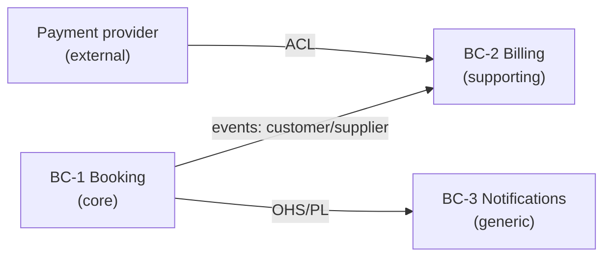

# Phase 4 — Domain modeling

| Key | Value |
|---|---|
| Central question | How is the business structured, and where should the boundaries be drawn? |
| Agent | [`prompts/domain-modeler.md`](../prompts/domain-modeler.md) |
| Inputs | Phases 1 to 3 approved, `glossary.md` |
| Outputs | `design/04-domain.md`, `glossary.md` (each term and its name in the code), `diagrams/` |
| Identifiers created | `BC-n` |
| Template | [`templates/04-domain.md`](../templates/04-domain.md) |
| Gate | G4 |

---

## 1. Why this phase

It bridges the problem (phases 1 to 3) and the solution (phases 5 to 12). It answers three questions on which the whole architecture depends:

1. **Which words** are used, with what exact meaning? (ubiquitous language)
2. **Where are the natural boundaries** of the business? (bounded contexts)
3. **Where should** the design effort **be invested**? (subdomain classification)

The method is that of Eric Evans's DDD (Domain-Driven Design), in its **strategic** part. The tactical part (aggregates, entities, value objects) is started here and detailed in phases 6 and 8.

## 2. Concepts and methods

### 2.1 Event Storming

A workshop technique by Alberto Brandolini. The business is reconstructed as a **timeline of business events**, written in the past tense ("Booking confirmed"). The agent runs it in three passes:

| Pass | Content | Result |
|---|---|---|
| **Big picture** | All the business events in chronological order, end to end. Hot spots (disagreements, unclear areas) flagged. | A timeline the business can read |
| **Process** | For each event: the **command** that causes it, the **actor** or **policy** ("when X, then Y") that triggers that command, the **external systems**, the **information read** to decide. | The flows and the automations |
| **Design** | Grouping of the commands and events around the **aggregates** that guarantee the rules. | The consistency boundaries |

Textual notation used by the agent (readable without any tool, easy to turn into Mermaid):

```
[Actor: Customer] → (Command: Book a slot) → {Aggregate: Booking}
    ⇒ <Event: Booking requested>
    ⇒ «Policy: when Booking requested, hold the slot for 10 min»
    ?? Hot spot: what happens if the payment fails after 10 min? → OD-5
```

Each hot spot becomes an OD (open decision). Each policy refers to one or more `BR-n`.

### 2.2 Ubiquitous language

A **single, shared** vocabulary used by the business, the documentation and the code, **within a bounded context**. The same word can legitimately have two meanings in two different contexts ("Customer" for billing and for support), but never two meanings in the same context.

The project glossary gives each term its English name in the code, in accordance with golden rule 13:

| Term | Context | Definition | Name in the code | Forbidden synonyms |
|---|---|---|---|---|
| Booking | `BC-1` Booking | A customer's commitment to a slot, from the request to the cancellation or the fulfillment | `Booking` | "order", "reservation" |
| Slot | `BC-1` Booking | A bookable time range of a resource | `Slot` | "schedule", "window" |
| Credit note | `BC-2` Billing | An amount owed to the customer, usable on a future purchase | `CreditNote` | "voucher", "refund" |

### 2.3 Subdomains

| Type | Definition | Strategy |
|---|---|---|
| **Core** | What differentiates the organization; its competitive advantage | Careful design, the best developers, a rich model, custom development |
| **Supporting** | Necessary, specific to the organization, but not differentiating | Simple development, a lightweight model |
| **Generic** | A problem solved the same way everywhere (authentication, standard invoicing, sending emails) | **Buy or reuse**: product, service or library |

This classification is one of the most cost-effective decisions of the project: it avoids spending the design effort on sending emails instead of on the pricing engine.

### 2.4 Bounded contexts (`BC-n`)

A BC (Bounded Context) is a boundary within which a model and its language are consistent. It is the **future module boundary**, and possibly the future service boundary.

Heuristics for placing the boundaries:

- the meaning of a term changes;
- another stakeholder is responsible for the rules;
- the pace of change differs;
- the data does not need to be immediately consistent on both sides;
- a business event marks a handover ("Booking confirmed" → billing takes over).

Context sheet:

| Section | Content |
|---|---|
| Name and identifier | `BC-1` Booking |
| Subdomain type | Core / Supporting / Generic |
| Responsibility | What the context guarantees, in one or two sentences |
| What it does not do | Responsibilities explicitly left to other contexts |
| Use cases and rules | The `UC-n` and `BR-n` it carries |
| Published events | Business events that the other contexts can listen to |
| Events and data consumed | What it expects from the others |
| Anticipated aggregates | First candidates (§ 2.6) |

### 2.5 Context map

It describes the **relationships** between contexts. Common patterns:

| Pattern | Meaning |
|---|---|
| **Partnership** | Two teams succeed or fail together; they coordinate their changes. |
| **Shared kernel** | A small common model, changed only by mutual agreement. To be kept to a minimum. |
| **Customer / supplier** | The upstream (supplier) takes the needs of the downstream (customer) into account. |
| **Conformist** | The downstream adopts the upstream's model as it is, since it cannot influence it. |
| **ACL** (Anti-Corruption Layer) | The downstream translates the upstream's model to protect its own model. Essential when facing a legacy or external system. |
| **OHS** (Open Host Service) + **PL** (Published Language) | The upstream exposes a stable, documented interface, in a published format, for all its consumers. |
| **Separate ways** | No integration: duplicate rather than couple. |

Expected Mermaid representation:



### 2.6 First tactical elements

Without going into technical detail, the agent identifies for each *Core* context:

| Element | Definition | Link with the requirements |
|---|---|---|
| **Aggregate** | A group of objects modified as a whole, which protects invariants. A transaction modifies only one aggregate. | The `BR-n` that must be true **immediately** designate the invariants of an aggregate. |
| **Entity** | An object with an identity that persists over time. | — |
| **Value object** | An object defined by its values alone, immutable (amount, time slot, address). | The `BR-n` on format validation or calculation naturally live there. |
| **Domain event** | A past business fact, significant to the business. | They come from the Event Storming; named in English in the past tense in the code (`BookingConfirmed`). |

Design rule: a `BR-n` that may become true **eventually** (a few seconds or minutes later) rather than immediately does not need to be in the same aggregate. This distinction prepares the consistency choices of phase 6.

## 3. Workshop flow

| Step | The agent | The decision-maker |
|---|---|---|
| 1 | Extracts a first timeline of business events from the `UC-n` and `BR-n`. | Corrects the order, adds what was missed. |
| 2 | *Process* pass: commands, actors, policies, external systems. Flags the hot spots. | Explains the policies, decides or opens ODs. |
| 3 | Proposes a classification of the subdomains, with a justification. | Decides: what really sets you apart? |
| 4 | Proposes a split into `BC-n` with the sheet of each one, and justifies each boundary by the heuristics of § 2.4. | Critiques the split. |
| 5 | Draws the context map. | Approves. |
| 6 | Identifies the aggregates, invariants and events of each *Core* context. | Confirms the invariants. |
| 7 | Gives each term of the glossary its English name in the code. | Approves the names. |
| 8 | Runs the checklist and invokes the critical reviewer. | Approves G4. |

## 4. Question bank

1. Walk me through a typical day in the business, from the arrival of the request until everything is done.
2. Does this term mean exactly the same thing to the sales department and to accounting?
3. Who has the last word on this rule? The same department as for that one?
4. What makes you better than your competitors? What could you outsource without losing your advantage?
5. If this information arrived a minute late, would that be serious?
6. What automatically triggers an action without human intervention?

## 5. Deliverables

| File | Minimum content |
|---|---|
| `04-domain.md` | Event timeline, subdomains, `BC-n` sheets, context map, aggregates and invariants of the *Core* contexts |
| `glossary.md` | Glossary by context: each term, its name in the code, forbidden synonyms |
| `diagrams/` | Context map and timeline in Mermaid format |

## 6. Gate G4 checklist

- [ ] ★ Every business term in the glossary has a definition and an English name for the code.
- [ ] ★ Every `UC-n` and every `BR-n` is attached to one and only one main `BC-n`.
- [ ] ★ Every `BC-n` has a justified subdomain type.
- [ ] The event timeline covers all the *Must* `UC-n` end to end.
- [ ] Every relationship in the context map has a named pattern.
- [ ] Every external system is isolated by an ACL or is the subject of an explicit decision to conform.
- [ ] The invariants of the *Core* aggregates refer to `BR-n`.
- [ ] The hot spots are all resolved or turned into ODs.

## 7. Anti-patterns

| Anti-pattern | Symptom | Correction |
|---|---|---|
| Split by technical entity | "Users", "Products", "Orders" contexts modeled on tables | Split by business capability and by the meaning of words, not by name. |
| Single model | A single `Customer` with 60 attributes for every use | One model per context, with translation at the boundaries. |
| Everything is core | No generic subdomain | Ask what could be bought or outsourced. |
| Giant aggregate | An aggregate that contains the whole order, its payments and its deliveries | Keep in the aggregate only what must be consistent **immediately**. |
| Developers' glossary | Technical terms ("entity", "repository", "payload") in the business glossary | The glossary describes the business; technical vocabulary goes in the [guide's glossary](glossary.md). |
