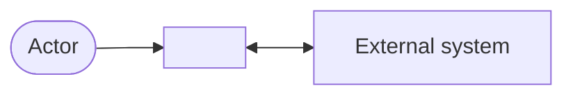

# 01 — Scoping — <Project name>

| Status | Version | Date | Gate |
|---|---|---|---|
| Draft / Proposed / Approved / Revised | 0.1 | <YYYY-MM-DD> | G1: — |

## 1. Vision

> **For** <target audience> **who** <need or problem>, **<product name>** is a <category> **that** <key benefit>. **Unlike** <current alternative>, our product <essential difference>.

**Current problem**: <who suffers it, how it is worked around today, what inaction costs>

## 2. Stakeholders

| Id | Stakeholder | Layer (product, system, organization, environment) | Interest | Influence | Representative |
|---|---|---|---|---|---|
| SH-1 | | | | High / Medium / Low | |

### Context of use (sketch)

<!-- For each group of end users (ISO (International Organization for Standardization) / IEC (International Electrotechnical Commission) 25063, § 4.2).
     With no end user, write it down: phase 5 will be reduced to the ergonomics of the API (Application Programming Interface) or of the command line. -->

| User group (SH) | Characteristics | Goals | Main tasks | Environment of use |
|---|---|---|---|---|
| SH-n | | | | |

## 3. Business objectives

| Id | Objective | Indicator | Starting value | Target | Deadline | Source |
|---|---|---|---|---|---|---|
| BO-1 | | | [threshold to be set] | | | |

## 4. Scope

**In scope**
- …

**Out of scope** (at least three items)
- …

**Later**
- …

### Business context diagram

## 5. Constraints

| Id | Constraint | Type (budget, schedule, legal, technical, organization) | Source | Negotiable? |
|---|---|---|---|---|
| C-1 | | | | No |

## 6. Existing situation

| Existing element | Nature (system, data, manual process, spreadsheet) | Relation to the project (replaced, integrated, kept) | Data to migrate? |
|---|---|---|---|
| | | | |

## 7. Initial hypotheses and risks

Recorded in the registers of `STATE.md`: H-1…, R-1…

## 8. Project profile

**Chosen profile**: Prototype / Product / Critical

**Rationale**: <data sensitivity, lifetime, financial or human stakes, traffic>

## 9. Solution leads expressed

<!-- Solutions mentioned by the stakeholders during scoping: kept
     here for phase 6, or for phase 5 if they describe a screen, with no
     decision value (golden rule 11). -->

- …
