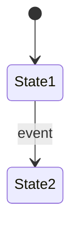

# 02 — Functional requirements — <Project name>

| Status | Version | Date | Gate |
|---|---|---|---|
| Draft | 0.1 | <YYYY-MM-DD> | G2: — |

## 1. Conventions

Volere framework for the requirements, Example Mapping for the examples. Each rule carries: **Rule**, **Fit criterion**, **Examples**, **Source**, **Rationale**, **Priority**.

A fit criterion must produce a test that fails deterministically. Those awaiting a value from the decision-maker are marked **[threshold to be set]** and attached to an OD (open decision).

Priority: *Must* if relaxing the rule produces an unrecoverable or silent error; *Should* if it produces a costly but visible error; *Could* for comfort; *Won't* for what is excluded from this version.

## 2. Actors

| Actor | Stakeholder | Description |
|---|---|---|
| | SH-n | |

## 3. Use case inventory

| Id | Title | Primary actor | Business objective | Priority | Context (phase 4) |
|---|---|---|---|---|---|
| UC-1 | | | BO-n | Must | |

## 4. Use cases

### UC-1 — <Title>

| Field | Content |
|---|---|
| Primary actor | |
| Goal | |
| Business objective | BO-n |
| Preconditions | |
| Success guarantees | |
| Minimal guarantees | |
| Rules applied | BR-n |
| Acceptance criteria | AC-n |
| Priority | |

**Nominal scenario**
1. The actor …
2. The system …

**Extensions**
- 2a. If …, then the system …

## 5. Business rules

### BR-1 — <Short title>

- **Rule**: <a single statement, preferably in the EARS (Easy Approach to Requirements Syntax) format>
- **Fit criterion**: <measurable condition>
- **Examples**:
  - BR-1.E1 (nominal) — Given …, when …, then …
  - BR-1.E2 (boundary) — Given …, when …, then …
- **Source**: <SH-n, document, law, decision-maker on a given date>
- **Rationale**: <why the rule exists>
- **Priority**: <Must / Should / Could / Won't — consequence of relaxing it>
- **Use case**: UC-n

## 6. Interaction requirements

<!-- For each use case whose actor is human: what the user must
     be able to do or see, never the appearance of the screen (principles § 7.4). -->

### IR-1 — <Short title>

- **Requirement**: <While / When …, the user must be able to …>
- **Fit criterion**: <condition verifiable by a journey test>
- **Examples**:
  - IR-1.E1 (nominal) — Given …, when …, then …
  - IR-1.E2 (boundary) — Given …, when …, then …
- **Source**:
- **Rationale**:
- **Priority**:
- **Use case**: UC-n

## 7. Acceptance criteria

<!-- Acceptance criteria are written in English Gherkin, whatever the language of the deliverables (golden rule 13), as below. -->

```gherkin
# AC-1 — verifies UC-1, BR-1
Given …
When …
Then …
```

## 8. Supplements

### 8.1 Life cycles of the business objects



### 8.2 Role × action matrix

| Action | Role A | Role B |
|---|---|---|
| | ✓ | — |

### 8.3 Notifications

| Triggering event | Recipient | Channel | Content | Rule |
|---|---|---|---|---|

### 8.4 User journeys

<!-- Sequence of the activities of each user group. The screens and their
     sketches are designed in phase 5 (05-interaction.md). -->

| User group | Activities, in order | Use cases (UC) |
|---|---|---|

### 8.5 Data migration

<!-- If the existing situation holds data to migrate: sources, transformation rules. -->
