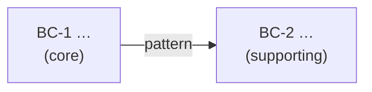

# 04 — Domain model — <Project name>

| Status | Version | Date | Gate |
|---|---|---|---|
| Draft | 0.1 | <YYYY-MM-DD> | G4: — |

## 1. Business event timeline

```
[Actor: …] → (Command: …) → {Aggregate: …}
    ⇒ <Event: … (past tense)>
    ⇒ «Policy: when …, then …» (BR-n)
    ?? Hot spot: … → OD-n
```

## 2. Subdomains

| Subdomain | Type (Core, Supporting, Generic) | Rationale | Strategy (build, simplify, buy) |
|---|---|---|---|
| | | | |

## 3. Bounded contexts

### BC-1 — <Name>

| Field | Content |
|---|---|
| Subdomain type | |
| Responsibility | |
| What it does not do | |
| Use cases and rules | UC-n, BR-n |
| Events published | |
| Events and data consumed | |
| Anticipated aggregates | |

## 4. Context map



| Relationship | Upstream | Downstream | Pattern | Rationale |
|---|---|---|---|---|
| | | | | |

## 5. Tactical elements of the *Core* contexts

### BC-1 — <Name>

| Aggregate | Invariants (BR-n) | Entities | Value objects | Events emitted (name in the code) |
|---|---|---|---|---|
| | | | | |
