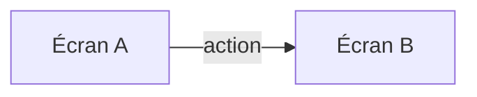

# 05 — Conception de l'interaction — <Nom du projet>

| Statut | Version | Date | Gate |
|---|---|---|---|
| Brouillon | 0.1 | <AAAA-MM-JJ> | G5 : — |

<!-- Sans utilisateur final (le système ne sert que d'autres systèmes ou des développeurs), ce document se
     réduit à l'ergonomie de l'API (Application Programming Interface) ou de la
     ligne de commande : nommage, messages d'erreur, cohérence des commandes. -->

## 1. Carte des écrans

| Écran | Ce qu'on peut y faire | Cas d'utilisation (UC) | Exigences d'interaction (IR) |
|---|---|---|---|
| <Nom de l'écran> | | UC-n | IR-n |

## 2. Spécification de l'interaction

### UC-n — <Titre>

| Étape | L'utilisateur | Le système affiche | Erreurs possibles |
|---|---|---|---|
| 1 | | | |

Schéma d'écran : <lien vers `prototypes/` ou schéma en basse fidélité>

## 3. États des écrans

| Écran | Vide | Chargement | Erreur | Partiel | Périmé | Droits insuffisants | Succès |
|---|---|---|---|---|---|---|---|
| | | | | | | | |

## 4. Besoins d'interaction significatifs pour l'architecture

| Scénario qualité (QS) | Besoin (scénario du SEI (Software Engineering Institute)) | Interaction décrite | Exigence transmise à la phase 6 |
|---|---|---|---|
| QS-n | | | |

## 5. Besoins par écran

<!-- Entrée de la phase 8 (contrats d'interface). -->

| Écran | Données lues | Actions envoyées | Fraîcheur attendue (à l'ouverture, sur demande, sans action de l'utilisateur) |
|---|---|---|---|
| | | | |

## 6. Prototype

| Parcours | Chemin dans `prototypes/` | Validé par le décideur le |
|---|---|---|
| UC-n | | |

## 7. Évaluation

| Date | Méthode (heuristiques, test avec des utilisateurs) | Constats | Suite donnée |
|---|---|---|---|
| | | | |
