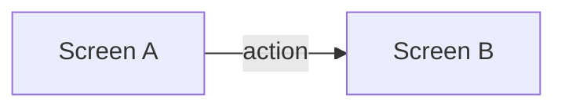

# 05 — Interaction design — <Project name>

| Status | Version | Date | Gate |
|---|---|---|---|
| Draft | 0.1 | <YYYY-MM-DD> | G5: — |

<!-- Without an end user (the system serves only other systems or developers), this document comes
     down to the ergonomics of the API (Application Programming Interface) or of the
     command line: naming, error messages, consistency of commands. -->

## 1. Screen map

| Screen | What can be done there | Use cases (UC) | Interaction requirements (IR) |
|---|---|---|---|
| <Screen name> | | UC-n | IR-n |

## 2. Interaction specification

### UC-n — <Title>

| Step | The user | The system displays | Possible errors |
|---|---|---|---|
| 1 | | | |

Screen sketch: <link to `prototypes/` or low-fidelity sketch>

## 3. Screen states

| Screen | Empty | Loading | Error | Partial | Stale | Insufficient permissions | Success |
|---|---|---|---|---|---|---|---|
| | | | | | | | |

## 4. Architecturally significant interaction needs

| Quality scenario (QS) | Need (scenario from the SEI (Software Engineering Institute)) | Interaction described | Requirement passed on to phase 6 |
|---|---|---|---|
| QS-n | | | |

## 5. Needs per screen

<!-- Input to phase 8 (interface contracts). -->

| Screen | Data read | Actions sent | Expected freshness (on opening, on request, without user action) |
|---|---|---|---|
| | | | |

## 6. Prototype

| Journey | Path in `prototypes/` | Approved by the decision-maker on |
|---|---|---|
| UC-n | | |

## 7. Evaluation

| Date | Method (heuristics, testing with users) | Findings | Follow-up |
|---|---|---|---|
| | | | |
