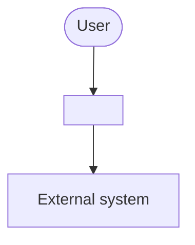
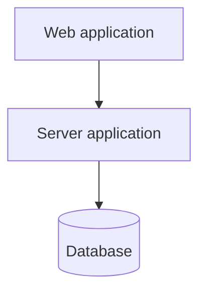
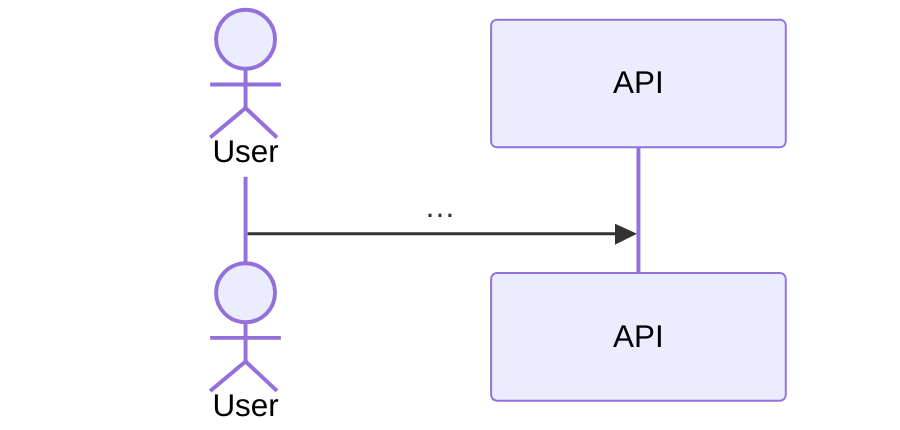

# 06 — Architecture — <Project name>

<!-- arc42 structure. Sections fed by other phases refer to the
     corresponding deliverables instead of copying them. -->

| Status | Version | Date | Gate |
|---|---|---|---|
| Draft | 0.1 | <YYYY-MM-DD> | G6: — |

## 1. Introduction and goals

Summary of the vision (see `01-scoping.md`) and of the significant quality scenarios (see `03-quality-requirements.md`):

| Scenario (QS) | Summary | Addressed by |
|---|---|---|
| QS-n | | ADR-nnnn |

## 2. Constraints

See `01-scoping.md` § 5. Constraints that bear on the architecture: C-n, …

## 3. Context and scope

C4 (Context, Containers, Components, Code) diagram, level 1:

## 4. Solution strategy

| Dimension | Choice | ADR (Architecture Decision Record) |
|---|---|---|
| Decomposition and deployment | | ADR-0001 |
| Internal organization of modules | | |
| Communication between modules | | |
| Data and consistency | | |
| Modeling per context | | |

## 5. Building block view

### 5.1 Containers (C4 level 2)

### 5.2 Mapping of contexts → modules

| Context (BC) | Module or service | Internal organization |
|---|---|---|
| BC-1 | | Hexagonal / Layered |

### 5.3 Components of the *Core* contexts (C4 level 3)

## 6. Runtime view

### 6.1 UC-n — nominal scenario

### 6.2 Failure scenario — <unavailable dependency>

## 7. Deployment view

<!-- Filled in during phase 10. -->

## 8. Cross-cutting concepts

| Concept | Decision | ADR |
|---|---|---|
| Error handling | | |
| Transactions and consistency | | |
| Idempotency | | |
| Concurrency | | |
| Time and time zones | | |
| Configuration and secrets | | |
| Logging, metrics, traces | | |
| Validation | | |
| Internationalization | | |
| Dependency rules (checked by FF-n) | | |

## 9. Architecture decisions

| ADR | Title | Status | Requirements |
|---|---|---|---|
| ADR-0001 | | Proposed | QS-n, C-n |

## 10. Quality requirements

See `03-quality-requirements.md`.

## 11. Risks and technical debt

| R | Description | Response |
|---|---|---|
| R-n | | |

## 12. Glossary

See `glossary.md`.
