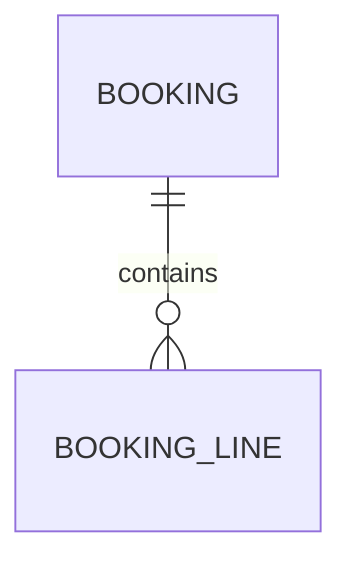

# 08 — Data and contracts — <Project name>

| Status | Version | Date | Gate |
|---|---|---|---|
| Draft | 0.1 | <YYYY-MM-DD> | G8: — |

## 1. Data ownership

| Data | Owning context | Consumers | Access mode |
|---|---|---|---|
| | BC-n | | Interface / Event / Read copy |

## 2. Logical models

### BC-1 — <Name>

| Integrity constraint | Rule guaranteed |
|---|---|
| | BR-n |

## 3. Cross-cutting choices

| Subject | Decision | ADR (Architecture Decision Record) |
|---|---|---|
| Identifiers | | |
| Amounts | | |
| Dates and times | | |
| Deletion | | |
| History and audit | | |
| Multi-tenancy | | |
| Text and encoding | | |

## 4. Classification and life cycle

| Data set | Sensitivity | Personal data | Retention (period, basis) | End of life | Volume |
|---|---|---|---|---|---|
| | | | | | |

## 5. Schema evolution

## 6. Migration of existing data

## 7. Interface design rules

| Subject | Rule |
|---|---|
| Naming | |
| Errors | |
| Pagination, sorting, filtering | |
| Idempotency | |
| Concurrency | |
| Versioning | |
| Compatibility and deprecation | |
| Authentication | See `09-security.md` |

Contracts: `contracts/openapi.yaml`, `contracts/asyncapi.yaml`.

## 8. Event catalog

| Event (name in the code) | Emitting context | Consumers | Content | Delivery | Ordering | Version |
|---|---|---|---|---|---|---|
| | BC-n | | Notification / State transfer | At least once | | 1 |

## 9. External integrations

| System | Contract | Anti-corruption layer | Authentication | Rate limits | Behavior when unavailable | Test environment |
|---|---|---|---|---|---|---|
| | | | | | QS-n | |
