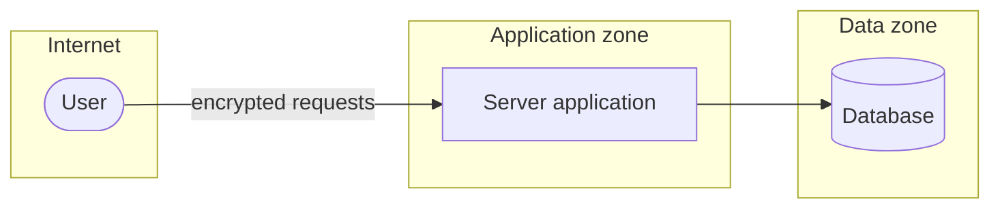

# 09 — Security and compliance — <Project name>

| Status | Version | Date | Gate |
|---|---|---|---|
| Draft | 0.1 | <YYYY-MM-DD> | G9: — |

## 1. Data flow diagram and trust boundaries

## 2. Threat register

<!-- STRIDE (Spoofing, Tampering, Repudiation, Information disclosure, Denial of service, Elevation of privilege) categories. -->

| Id | Element or flow | Category | Scenario | Likelihood | Impact | Response | Countermeasure | Verification | Status |
|---|---|---|---|---|---|---|---|---|---|
| T-1 | | | | | | | ADR (Architecture Decision Record) / BR-n / QS-n | | Open |

## 3. Requirement level

Target ASVS (Application Security Verification Standard) level: <1 / 2 / 3>. Requirements carried over: QS-n, BR-n.

## 4. Security decisions

| Subject | Decision | ADR (Architecture Decision Record) |
|---|---|---|
| Authentication | | |
| Sessions and tokens | | |
| Authorization | | |
| Input validation | | |
| Encryption in transit and at rest | | |
| Secrets | | |
| Security logging | | |
| Abuse protection | | |
| Supply chain | | |
| Incident management | | |

## 5. Personal data protection

| Processing | Purpose | Legal basis | Data | Duration | Data subjects' rights (UC-n) | Processors | Transfer outside the European Union |
|---|---|---|---|---|---|---|---|
| | | | | | | | |

Impact assessment required: Yes / No / To be determined with the legal counsel — rationale.

## 6. Other compliance areas

| Framework | Applicable? | Constraint created |
|---|---|---|
| | | C-n |
